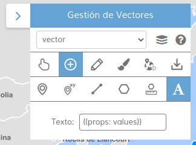

<p align="center">
  
</p>
<h1 align="center"><strong>API IDEE</strong> <small>🔌 IDEE.plugin.VectorsManagement</small></h1>

# Descripción

Plugin que permite el dibujo y edición de geometrías sobre un mapa, cálculo de perfiles topográficos y áreas de influencia, así como su descarga.

|  Herramienta abierta  |Herramienta cerrada
|:----:|:----:|
|||

# Dependencias
Para que el plugin funcione correctamente es necesario importar las siguientes dependencias en el documento html:

Para uso de implementación OpenLayers:
- **vectorsmanagement.ol.min.js**
- **vectorsmanagement.ol.min.css**

Para uso de implementación Cesium:
- **vectorsmanagement.cesium.min.js**
- **vectorsmanagement.cesium.min.css**

```html
 <link href="https://componentes.idee.es/api-idee/plugins/vectorsmanagement/vectorsmanagement.ol.min.css" rel="stylesheet" />
 <script type="text/javascript" src="https://componentes.idee.es/api-idee/plugins/vectorsmanagement/vectorsmanagement.ol.min.js"></script>
```

# Uso del histórico de versiones

Existe un histórico de versiones de todos los plugins de API-IDEE en [api-idee-legacy](https://github.com/Desarrollos-IDEE/API-IDEE/tree/master/api-idee-legacy/plugins) para hacer uso de versiones anteriores.
Ejemplo:
```html
 <link href="https://componentes.idee.es/api-idee/plugins/vectorsmannagement/vectorsmanagement-1.0.0.ol.min.css" rel="stylesheet" />
 <script type="text/javascript" src="https://componentes.idee.es/api-idee/plugins/vectorsmanagement/vectorsmanagement-1.0.0.ol.min.js"></script>
```

# Parámetros

El constructor se inicializa con un JSON con los siguientes atributos:


- **position**:  Ubicación del plugin sobre el mapa.
  - 'left' (LEFT) - A la izquierda.
  - 'right' (RIGHT) - A la derecha.
- **collapsed**: Indica si el plugin viene colapsado de entrada (true/false). Por defecto: true.
- **collapsible**: Indica si el plugin puede abrirse y cerrarse (true) o si permanece siempre abierto (false). Por defecto: true.
- **order**: Determina la prioridad visual dentro del contenedor. Un valor más alto desplaza el botón hacia el final del flujo.
- **selection**: Indica si se incluye la herramienta de selección de elementos (true/false). Por defecto: true.
- **addlayer**: Indica si se incluye la herramienta de creación de capas vectoriales (true/false). Por defecto: true.
- **analysis**: Indica si se incluye la herramienta de análisis (cálculo de perfil topografico y área de influencia) (true/false). Por defecto: true. Es necesario tener añadida la herramienta de selección para poder añadir esta.
- **creation**: Indica si se incluye la herramienta de dibujo (true/false). Por defecto: true. Es necesario tener añadida la herramienta de selección para poder añadir esta.
- **download**: Indica si se incluye la herramienta de descarga de elementos y capas vectoriales (true/false). Por defecto: true. Es necesario tener añadida la herramienta de selección para poder añadir esta.
- **edition**: Indica si se incluye la herramienta de edición de elementos (true/false). Por defecto: true. Es necesario tener añadida la herramienta de selección para poder añadir esta.
- **help**: Indica si se incluye la herramienta de ayuda (true/false). Por defecto: true.
- **style**: Indica si se incluye la herramienta de edición de estilos (true/false). Por defecto: true. Es necesario tener añadida la herramienta de selección para poder añadir esta.
- **turf**: Indica si se incluye la herramienta de geoprocesos con Turf.js (true/false). Por defecto: true. Es necesario tener añadida la herramienta de selección para poder añadir esta. Requiere una versión de API-IDEE que publique Turf.js (`window.turf`). Ver [Geoprocesos con Turf.js](#geoprocesos-con-turfjs).
- **snapping**: Configuración inicial del ajuste (snapping) que usan las herramientas de dibujo (`creation`) y de edición (`edition`). El usuario puede modificarla después desde la interfaz del plugin. Si ambas herramientas están desactivadas (`false`), este parámetro no tiene efecto. Valores posibles:
  - `true`: snapping activado con los valores por defecto. Es el valor por defecto.
  - `false`: snapping desactivado (el usuario puede activarlo desde la interfaz).
  - Objeto JavaScript, JSON o JSON en base64: snapping activado con esa configuración. Las propiedades que no se indiquen toman su valor por defecto y las que no estén contempladas se ignoran. Si el valor no es un JSON ni un base64 válido, se muestra un error y se usan los valores por defecto.

  | Propiedad | Descripción | Por defecto |
  |---|---|---|
  | **vertex** | Ajuste a los vértices de las geometrías existentes (true/false). | true |
  | **edge** | Ajuste a cualquier punto de las aristas de líneas y polígonos (true/false). | true |
  | **intersection** | Ajuste a los puntos donde se cruzan dos segmentos (true/false). | false |
  | **allLayers** | Ajuste a todas las capas vectoriales visibles y no solo a la capa seleccionada (true/false). | false |
  | **guides** | Muestra guías ortogonales y paralelas y se ajusta a ellas. Solo al dibujar líneas, polígonos o agujeros (true/false). | false |
  | **pixelTolerance** | Distancia en píxeles para realizar el ajuste. También es la distancia para seleccionar un vértice al editar una geometría. | 10 |

  ```javascript
  snapping: { intersection: true, allLayers: true, pixelTolerance: 12 },
  ```

# API-REST

## Edición espacial DataIDEE (OpenLayers)

La edición trabaja con una zona CRS84 fija. Antes de habilitarla carga todas las
páginas y rechaza una preparación incompleta o que supere los límites
configurables de la capa: por defecto 250 entidades por página, 1.000
entidades, 100.000 coordenadas y 10 MiB de GeoJSON. Durante la sesión, navegar
por el mapa no consulta ni sustituye los datos. Guardar envía cambios
secuencialmente; los éxitos parciales permanecen confirmados y el resto puede
descartarse o revisarse.

Para probar los cambios sin dependencias adicionales, compila el núcleo y el
plugin, y arranca el servicio local:

```sh
npm run build:ol-core
npm run build --prefix src/plugins/vectorsmanagement
node src/plugins/vectorsmanagement/test/demo/dataidee-server.js
```

Abre `http://127.0.0.1:8787` para editar la colección local. Los cambios se
mantienen mientras el proceso esté activo; restaura la colección con
`POST /local/reset`. Los modos `readonly`, `dense`, `complex`, `conflict`,
`partial`, `write-error` y `uncertain` sirven para comprobar permisos, límites,
conflictos, éxitos parciales, validación y respuestas de escritura perdidas.

Abre `http://127.0.0.1:8787/teunesco.html` para iniciar sesión y editar las
colecciones `externa:puntos` y `externa:estaciones` directamente. El token se
mantiene solo en memoria. Usa el selector de capas de VectorsManagement; para
crear entidades, introduce `nombre` y, en estaciones, un identificador entero.
Los puntos reciben su identificador del servidor. La sesión limita los cambios
a la extensión visible al iniciarla; guarda, descarta o cancela antes de
finalizarla o cambiar de capa.

```javascript
URL_API?vectorsmanagement=position*!collapsed*!order*!selection*!addlayer*!analysis*!creation*!download*!edition*!help*!style*!snapping*!turf
```
Ejemplo:
```javascript
https://componentes.idee.es/api-idee/?vectorsmanagement=RIGHT*true*true
```

# Geoprocesos con Turf.js

La herramienta de geoprocesos ejecuta operaciones de [Turf.js](https://turfjs.org/) sobre las capas vectoriales del mapa, se hayan añadido con el plugin, con el Layerswitcher o con la API (`IDEE.layer.Vector` y sus subtipos: GeoJSON, KML, WFS, OGCAPIFeatures...). Todas se configuran en un formulario del panel, que no bloquea el mapa: mientras está abierto se puede cambiar de capa y seleccionar entidades.

## Entradas

Cada operación declara sus entradas (papeles). En cada una se eligen una o varias capas y, para cada capa, el ámbito:

- **Todas las entidades de la capa.**
- **Solo las seleccionadas:** las de la selección guardada de esa capa.
- **Una entidad seleccionada:** una entidad de esa selección, elegida en una lista. Permite comparar o medir dos entidades, también de la misma capa.
- **Resultado de una operación anterior:** una capa creada por Turf, para encadenar operaciones.

Las capas teseladas (MVT, MBTilesVector), las que no tienen elementos cargados y las de tipos de geometría no admitidos aparecen deshabilitadas, con el motivo. Algunas entradas exigen un número de entidades (por ejemplo, exactamente una en las relaciones y la distancia).

Al abrir el formulario, la primera entrada usa la capa activa del plugin: su selección si la herramienta de selección está activa o, si no, todas sus entidades. Las relaciones, la distancia y «Restar polígonos» toman la primera y la segunda entidad seleccionadas, como hacían antes al pulsarlas con dos entidades seleccionadas.

**Selecciones guardadas.** Lo que se selecciona con la herramienta de selección se guarda por capa para Turf. Así se pueden combinar selecciones de varias capas aunque la selección del plugin solo se vea en la capa activa. El panel muestra cada selección guardada, cuántos elementos tiene y si se está viendo en el mapa, y permite quitarlas. Vaciar la selección en el mapa no vacía la selección guardada.

## Resultados y atributos

Antes de ejecutar, el formulario muestra qué entidades se van a procesar, el esquema de la capa resultante, los avisos y los errores que impiden ejecutar. Las operaciones de medición y de relación devuelven un valor (toast o diálogo). El resto crea una capa nueva con la leyenda `Turf: <operación> (n)` y el nombre interno `turf_<operación>_<n>_<aleatorio>`; si no hay resultados, no se crea ninguna capa. Las capas de origen no se modifican y los elementos de salida tienen identificadores nuevos.

- Se eligen los campos que se copian de cada entrada y su prefijo. Dentro de una entrada con varias capas, los campos con el mismo nombre comparten columna (cada resultado procede de una sola entidad de esa entrada). Entre entradas distintas, si dos campos acaban con el mismo nombre, el segundo recibe un sufijo `_2`, `_3`...; el orden lo fijan los papeles y los campos, nunca los elementos.
- La opción «Añadir la capa de origen» añade la columna `capa_origen`.
- Cuando varias entidades forman un único resultado (fusionar, parte común, restar, envolventes y área de influencia disuelta), se añade `num_entidades`. Sus campos solo se copian si se eligen y sus valores se combinan según «Valores de los campos combinados»: valores distintos separados por comas o el valor común (vacío si difieren). Nunca se toma el de una entidad cualquiera.

| Categoría | Operación | Entradas | Resultado |
|---|---|---|---|
| Área de influencia | `buffer` | Entrada (cualquier geometría) | Un polígono por entidad con sus campos, o uno disuelto. Distancia (negativa solo con polígonos), unidades lineales y pasos |
| Reunir, extraer y excluir | `mergeFeatures` | Entrada | Copia de las entidades elegidas, sin modificar geometrías ni campos. Reúne varias capas o extrae una selección. Avisa si mezcla puntos, líneas y polígonos |
| Reunir, extraer y excluir | `excludeFeatures` | Entrada + Exclusión | Las entidades de entrada que no están en la exclusión. Compara la identidad de las entidades (capa y posición), no su geometría |
| Reunir, extraer y excluir | `extractByLocation` | Entrada + Condición | Las entidades de entrada, sin recortar, que cumplen `intersects`, `disjoint`, `within` o `contains` con alguna entidad de condición (`disjoint`: con ninguna) |
| Superposición de capas | `layerIntersection` | Entrada (punto, línea o polígono) + Superposición (polígonos) | La parte común de cada pareja, con la dimensión de la entrada y los campos de ambos |
| Superposición de capas | `layerUnion` | Entrada + Superposición (polígonos) | Como la unión de QGIS: partes comunes (campos de ambos) y partes sin solape (campos de la otra entrada a `null`) |
| Superposición de capas | `layerDifference` | Entrada (punto, línea o polígono) + Superposición (polígonos) | La parte de cada entidad de entrada fuera de la superposición |
| Atributos espaciales | `spatialJoin` | Destino + Unión | La geometría del destino con los campos de las entidades de unión relacionadas. Relación `intersects`, `within` o `contains`; coincidencias múltiples: una salida por coincidencia o la de mayor solape |
| Combinar polígonos | `union` | Polígonos | Su unión (disolución) en una geometría; las partes separadas, multiparte o una entidad por parte con su procedencia |
| Combinar polígonos | `intersect` | Polígonos (2 o más) | La zona común a todos |
| Combinar polígonos | `difference` | Partida + Polígonos que se restan | La unión de los de partida menos la de los que se restan (los que también son de partida no se restan) |
| Medición | `area`, `length` | Polígonos / líneas | Suma de áreas¹ o longitudes² (los solapes se cuentan una vez por entidad) |
| Medición | `distance` | Origen + Destino (1 punto cada uno) | Distancia² |
| Medición | `bbox` | Entrada | Extensión en EPSG:4326 |
| Medición | `along` | Líneas (LineString) | Un punto por línea, a la distancia² indicada, con sus campos |
| Centros | `center`, `centroid`, `centerOfMass`, `pointOnFeature` | Entrada | Un punto por entidad con sus campos |
| Transformación | `simplify`, `bezierSpline`, `transformRotate`, `transformScale`, `transformTranslate` | Entrada | Una geometría transformada por entidad con sus campos |
| Transformación | `convex`, `envelope` | Entrada | Un polígono que contiene todas las entidades |
| Relación | `booleanPointInPolygon`, `booleanIntersects`, `booleanContains`, `booleanWithin` | Primera + Segunda (1 entidad cada una) | Sí / No |

¹ Metros, milímetros, centímetros, kilómetros, millas, millas náuticas, pulgadas, yardas y pies cuadrados, acres y hectáreas.

² Metros, milímetros, centímetros, kilómetros, millas, millas náuticas, pulgadas, yardas, pies, radianes y grados (el área de influencia solo admite las lineales).

Las relaciones y las políticas que no se pueden aplicar a los tipos de geometría elegidos no se ofrecen. Las operaciones también se pueden ejecutar desde código; `runLayerOperation` devuelve `{ layer, count, skipped }` o, en las de medición y relación, `{ value, skipped }`:

```javascript
const turfControl = vectorsManagement.controls[0].turfControl;
turfControl.runLayerOperation('spatialJoin', {
  inputs: {
    target: [{ layerId: puntos.idLayer, scope: 'selection' }],
    join: [{ layerId: zonas.idLayer, scope: 'all' }],
  },
  params: { predicate: 'within', matchPolicy: 'oneToMany', keepUnmatched: true },
  attributes: { join: { fields: ['nombre'], prefix: 'zona_' } },
  outputName: 'Puntos con zona',
});
turfControl.runLayerOperation('union', {
  inputs: {
    input: [
      { layerId: zonas.idLayer, scope: 'feature', featureKey: 'id:Z1' },
      { layerId: ambitos.idLayer, scope: 'selection' },
    ],
  },
  params: { separateParts: false, fieldPolicy: 'distinct', sourceLayer: true },
  attributes: { input: { fields: ['nombre'] } },
});
```

`featureKey` identifica una entidad de la selección guardada de su capa: `id:<identificador>` o, si no tiene un identificador único, `#<posición en la capa>`.

Limitaciones: la superposición y «Restar polígonos» solo admiten polígonos en el papel que recorta o resta, y la unión de capas, también en la entrada. Los tramos de línea que coinciden con un borde no se cortan en sus extremos. Solo se procesan los elementos cargados en el cliente (por ejemplo, los limitados por `limit` en OGCAPIFeatures).

## Añadir operaciones

Cada operación se define en un módulo de `src/facade/js/turf/operations/`, agrupado por categoría, con el contrato `LayerOperation` de `turf/turftypes.js`: sus papeles de entrada, sus parámetros, si devuelve geometrías (`Output.GEOMETRY`) o un valor (`Output.VALUE`) y su `execute`, que devuelve geometrías con su procedencia (nunca propiedades) o el valor. Los constructores habituales están en `operations/common.js` (`eachFeature`, `combineAll`, papeles) y `operations/params.js` (unidades, capa de origen, combinación de campos). Después se añade a la lista de `turf/turfoperations.js` con sus traducciones, incluidos sus papeles (`turf.ops.<id>.roles`). Los algoritmos reutilizables están en `turf/geometry/`, el esquema de atributos en `turf/attributes/`, la integración con las capas del mapa en `turf/layers/` y la interfaz en `turf/ui/`.

Turf.js lo publica el núcleo de API-IDEE como variable global `turf`, igual que `ol` o `proj4`, por lo que también se puede usar directamente:

```javascript
const buffered = turf.buffer(turf.point([-3.7, 40.4]), 500, { units: 'meters' });
```

# Atajos de teclado

| Atajo | Herramienta | Acción |
|---|---|---|
| Mantener pulsada **Ctrl** | Dibujo y edición | Desactiva temporalmente el snapping mientras se mantiene pulsada. |
| **Alt + clic** sobre un vértice | Edición ("Editar geometría") | Elimina el vértice. |

# Ejemplo de uso

```javascript
const map = IDEE.map({
    container: 'map'
});

const mp = new IDEE.plugin.VectorsManagement({
    position: 'right',
    collapsible: true,
    collapsed: true,
    order: 1,
    selection: true,
    addlayer: true,
    creation: true,
    edition: true,
    style: true,
    analysis: true,
    download: true,
    help: true,
    turf: true,
    snapping: { intersection: true, allLayers: true },
});

map.addPlugin(mp);
```

Para crear etiquetas durante la digitalización de elementos vectoriales, se tiene que usar la herramienta de creación con la funcionalidad texto activada.
El campo se tiene que rellenar con el nombre de la propiedad y el valor con el formato ```{{}}```, por ejemplo:


# 👨‍💻 Desarrollo

Para el stack de desarrollo de este componente se ha utilizado

* NodeJS Version: 14.16
* NPM Version: 6.14.11
* Entorno Windows.

## 📐 Configuración del stack de desarrollo / *Work setup*


### 🐑 Clonar el repositorio / *Cloning repository*

Para descargar el repositorio en otro equipo lo clonamos:

```bash
git clone [URL del repositorio]
```

### 1️⃣ Instalación de dependencias / *Install Dependencies*

```bash
npm i
```

### 2️⃣ Arranque del servidor de desarrollo / *Run Application*

```bash
npm start:ol
npm start:cesium
```

`test/dev.html` (http://localhost:6123/test/dev.html) carga el núcleo de API-IDEE, el Layerswitcher y PrintViewManagement desde el WAR desplegado en Tomcat (`http://localhost:8080/api-idee/`); el plugin se sirve desde el código fuente. `test/test.js` añade las capas de ejemplo de `test/turfsamples.js` para probar los geoprocesos de Turf.

## 📂 Estructura del código / *Code scaffolding*

```any
/
├── src 📦                  # Código fuente
├── task 📁                 # EndPoints
├── test 📁                 # Testing
├── webpack-config 📁       # Webpack configs
└── ...
```
## 📌 Metodologías y pautas de desarrollo / *Methodologies and Guidelines*

Metodologías y herramientas usadas en el proyecto para garantizar el Quality Assurance Code (QAC)

* ESLint
  * [NPM ESLint](https://www.npmjs.com/package/eslint) \
  * [NPM ESLint | Airbnb](https://www.npmjs.com/package/eslint-config-airbnb)

## ⛽️ Revisión e instalación de dependencias / *Review and Update Dependencies*

Para la revisión y actualización de las dependencias de los paquetes npm es necesario instalar de manera global el paquete/ módulo "npm-check-updates".

```bash
# Install and Run
$npm i -g npm-check-updates
$ncu
```

## Tabla de compatibilidad de versiones   
[Consulta el api resourcePlugin](https://componentes.idee.es/api-idee/api/actions/resourcesPlugins?name=vectorsmanagement)
